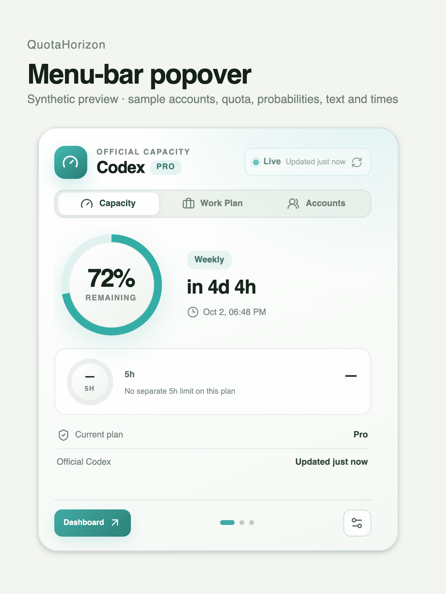
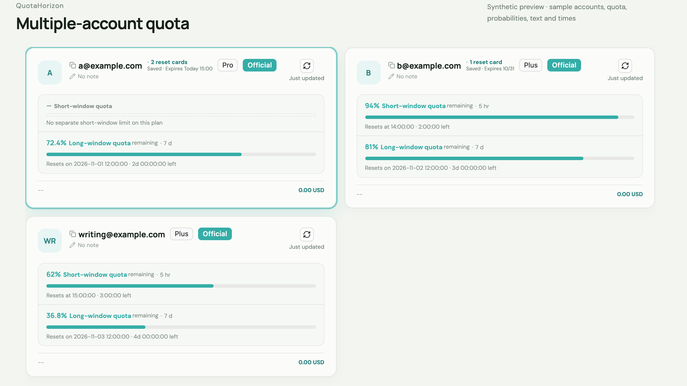
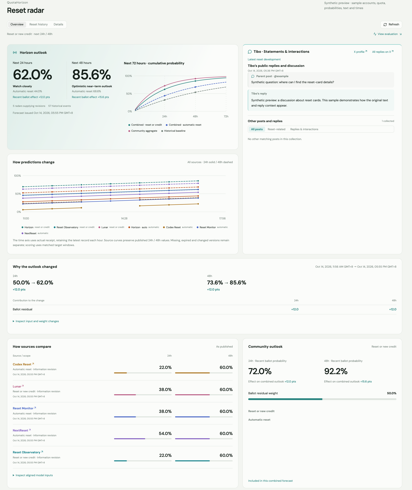
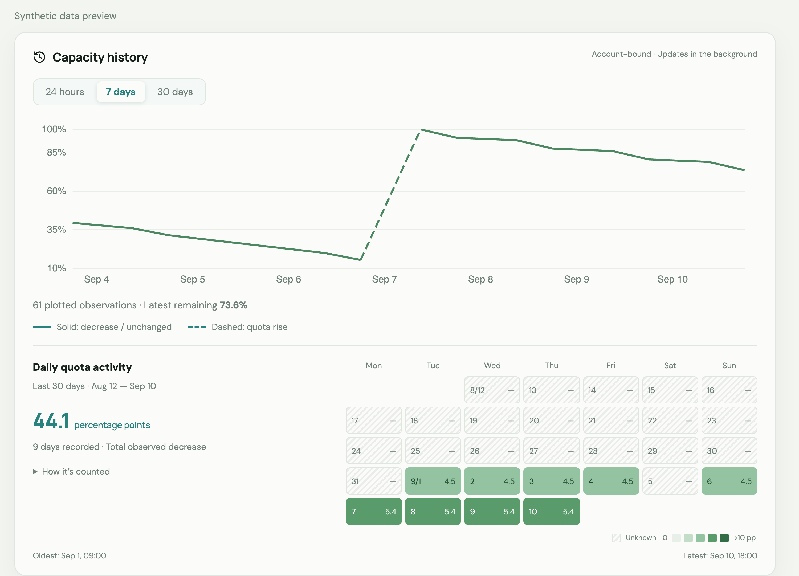

# QuotaHorizon

[简体中文](README.md) · **English**

Check Codex quota from the menu bar or system tray and manage accounts, schedules, history and sessions in one window.
QuotaHorizon also collects reset forecasts and related public statements to keep quota and reset information close at hand.

## Download and install

[**Download for macOS / Windows**](https://github.com/QuotaHorizon/Quota-Horizon/releases) · [Installation help](docs/INSTALLATION.en.md)

| Platform | Installation |
| --- | --- |
| macOS 13+ · Apple Silicon (M-series) | Download the `.dmg`, open it and drag QuotaHorizon into Applications |
| Windows x64 | Download the `.exe` and follow the installer |

Open QuotaHorizon after installation and follow the prompt to connect your signed-in local Codex installation.
Both installers include the forecasting and evaluation modules; collection starts when you open the app.

## Features

- **Menu-bar and tray monitoring**: background refresh, remaining quota and reset times; monitoring continues after the window closes.
- **Account overview**: compare quota, plans and refresh status, and switch the active login when needed.
- **Quota history**: trends and an activity heatmap, with dashed lines for quota increases.
- **Work schedules**: set working and unavailable hours to allocate remaining quota across days.
- **Session management**: search, read, resume, archive, restore and repair sessions.
- **Reset radar**: compare 24/48-hour combined forecasts, track 24h probabilities with Horizon candlesticks and source lines, and read community ballots, Tibo posts and reply context.
- **Forecast evaluation**: track forecasts against actual resets and credit grants, with scores, calibration and source comparisons.
- **Providers and CPA**: manage API connections and connect a configured CPA quota pool.

## Interface

These screenshots use actual product components. Menu, account and history previews use synthetic data; the radar uses a snapshot of collected public information.

**Menu-bar popover**: quota, reset countdowns and access to accounts.

**Account overview**: quota, plan type, reset times and reset-card expiry for each account.

**Reset radar** (2026-10-30 snapshot): combined outlook, 24h probability candlesticks and source comparisons, community inputs and full statements.

**Quota history**: usage trends and an activity heatmap.

[View the dark interface](docs/images/history-dark.en.png)

## Data and settings

Accounts, history and sessions are stored locally. Reset radar automatically collects public information and displays source names and update times.

[Configuration](docs/CONFIGURATION.en.md) · [Reset radar](docs/CONFIGURATION.en.md#reset-radar) · [Updates and history access](docs/INSTALLATION.en.md#update)

## Build from source

See the [development guide](docs/DEVELOPMENT.en.md) for local setup, installer builds and tests.

## Open source

QuotaHorizon builds on Codex Switch `v1.3.5` and is an open-source project independent of OpenAI.
Licensed under [Apache-2.0](LICENSE). See [NOTICE](NOTICE) and [UPSTREAM.md](UPSTREAM.md) for attribution and changes.
