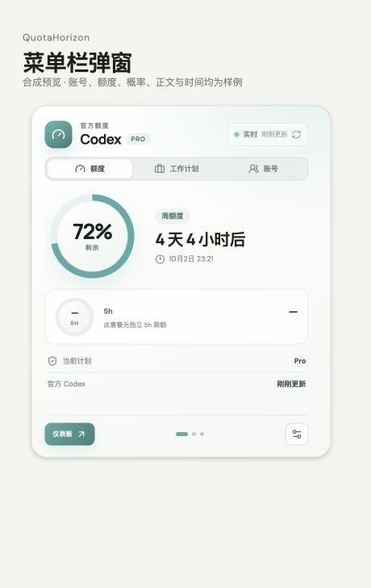
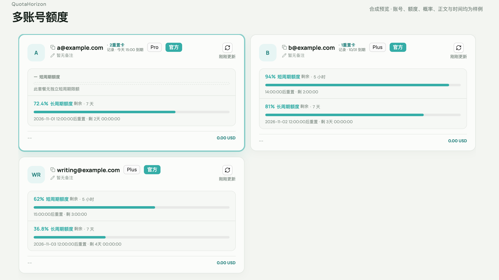
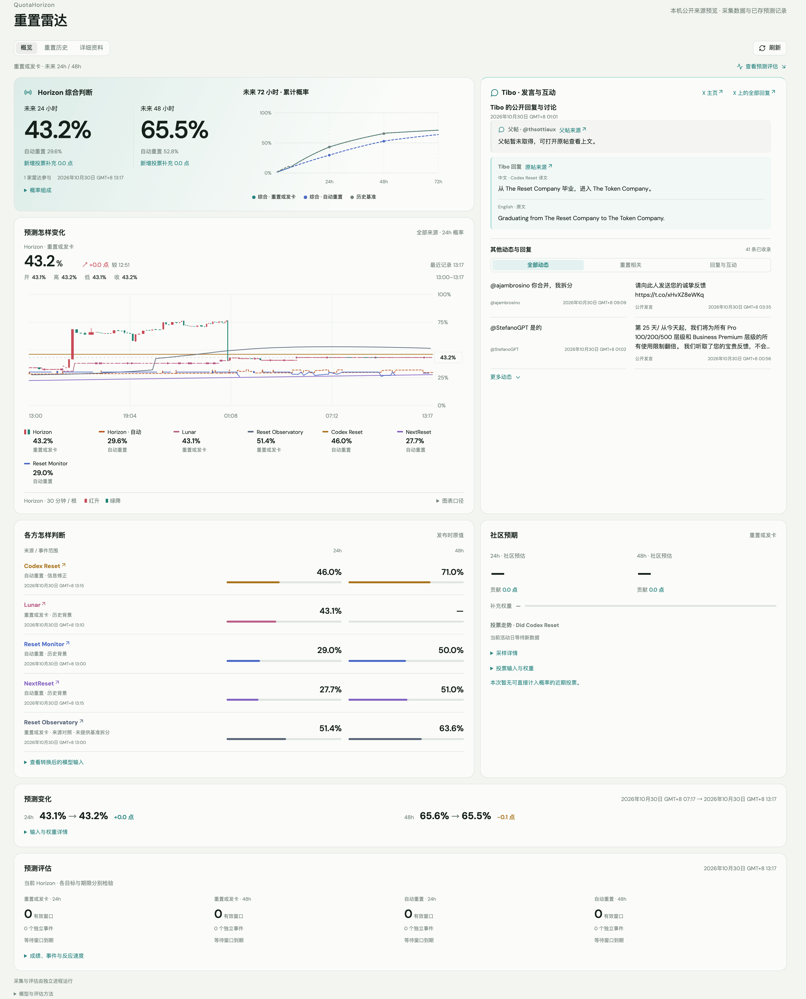
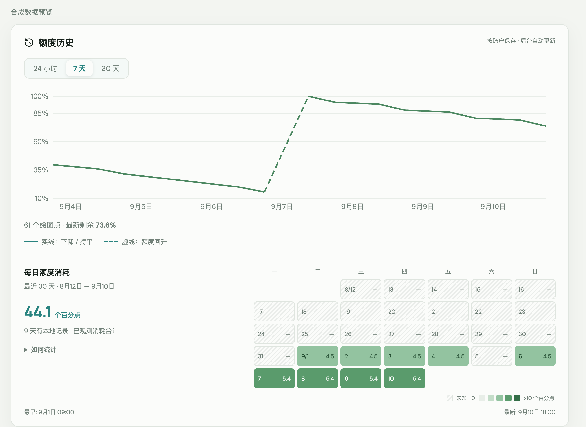

# QuotaHorizon

**简体中文** · [English](README.en.md)

在菜单栏或系统托盘查看 Codex 额度，在一个窗口里管理账号、日程、历史和会话。
QuotaHorizon 还会自动汇集重置预测和相关公开发言，方便随时了解额度与重置动态。

## 下载与安装

[**下载 macOS / Windows 版**](https://github.com/QuotaHorizon/Quota-Horizon/releases) · [安装帮助](docs/INSTALLATION.md)

| 平台 | 安装方式 |
| --- | --- |
| macOS 13+ · Apple Silicon（M 系列） | 下载 `.dmg`，打开后将 QuotaHorizon 拖入 Applications |
| Windows x64 | 下载 `.exe`，运行安装向导 |

安装后打开 QuotaHorizon，按提示连接本机已登录的 Codex。
两端安装包均自带重置预测与评估模块，打开应用即可开始采集。

## 功能

- **菜单栏与托盘监控**：后台刷新额度，显示剩余比例和重置时间；关窗后继续运行。
- **多账号总览**：并列查看各账号额度、套餐和刷新状态，按需切换登录。
- **额度历史**：趋势图与活动热图，使用虚线区分额度回升。
- **工作日程**：设置工作和停用时段，将剩余额度分配到每天。
- **会话管理**：搜索、阅读、继续会话，以及归档、恢复和修复。
- **重置雷达**：并列查看 24/48 小时综合预测，通过 24h 概率 K 线与来源细线对比走势，阅读社区投票、Tibo 发言与回复上下文。
- **预测评估**：持续记录预测和实际重置、发卡事件，查看评分、校准与来源对照。
- **Provider 与 CPA**：管理 API 连接，并接入自行配置的 CPA 额度池。

## 界面

以下为实际产品组件的合成数据预览。

**菜单栏弹窗**：额度、重置倒计时与账号入口。

**多账号总览**：各账号的额度、套餐、重置时间和重置卡到期状态。

**重置雷达**：综合判断、24h 概率 K 线与来源对照、社区信息和完整发言。

**额度历史**：用量趋势和活动热图。

[查看深色界面](docs/images/history-dark.png)

## 数据与配置

账号、历史和会话保存在本机。重置雷达自动汇集公开信息，标注来源与更新时间。

[配置说明](docs/CONFIGURATION.md) · [重置雷达](docs/CONFIGURATION.md#重置雷达) · [更新与历史访问](docs/INSTALLATION.md#更新)

## 从源码构建

本地运行、构建安装包和测试命令见[开发指南](docs/DEVELOPMENT.md)。

## 开源

QuotaHorizon 基于 Codex Switch `v1.3.5` 构建，是独立于 OpenAI 的开源项目。
采用 [Apache-2.0](LICENSE) 许可证，来源与修改说明见 [NOTICE](NOTICE) 和 [UPSTREAM.md](UPSTREAM.md)。
